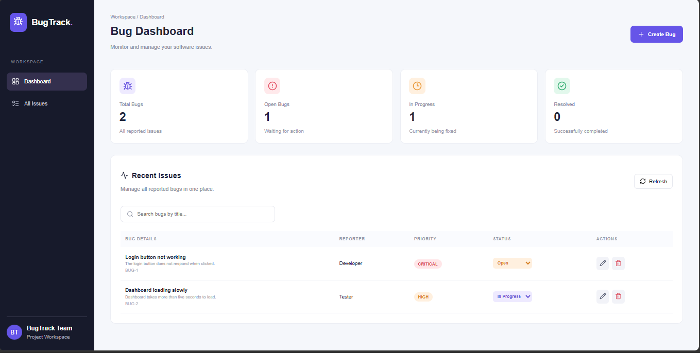

# 🐞 BugTrack – Bug Tracking and Issue Management System

A full-stack web application designed to manage, track, and monitor software bugs efficiently. BugTrack provides a dashboard where users can create issues, assign priorities, update bug statuses, and manage reported issues.

## 🚀 Features

- **Dashboard:** View total bugs, open bugs, in-progress bugs, and resolved bugs.
- **Create Bugs:** Report new software issues with titles and descriptions.
- **View Bugs:** Display all reported issues in one place.
- **Update Bugs:** Edit bug details, priorities, and statuses.
- **Delete Bugs:** Remove reported issues.
- **Priority Management:** Categorize bugs as Critical, High, Medium, or Low.
- **Status Tracking:** Track bugs using Open, In Progress, and Resolved statuses.
- **Search:** Search bugs by title.
- **Data Persistence:** Store bug records in MySQL.

## 🛠️ Technologies Used

### Frontend
- React.js
- JavaScript
- HTML5
- CSS3
- Axios
- Lucide React

### Backend
- Java
- Spring Boot
- Spring Data JPA
- Spring Web
- Maven
- REST APIs

### Database
- MySQL

### Development Tools
- Visual Studio Code
- MySQL Workbench
- Postman
- Git and GitHub

## 🏗️ Project Architecture

```text
BugTrack/
│
├── backend/
│   ├── src/main/java/com/bugtrack/backend/
│   │   ├── controller/
│   │   ├── entity/
│   │   ├── repository/
│   │   ├── service/
│   │   └── BackendApplication.java
│   │
│   ├── src/main/resources/
│   │   └── application.properties
│   └── pom.xml
│
├── frontend/
│   ├── public/
│   ├── src/
│   │   ├── assets/
│   │   ├── App.jsx
│   │   ├── App.css
│   │   ├── index.css
│   │   └── main.jsx
│   └── package.json
│
├── .gitignore
└── README.md
```

## ⚙️ Installation and Setup

### Prerequisites

Make sure you have installed:

- Java 21
- Node.js and npm
- MySQL Server
- Git

### 1. Clone the Repository

```bash
git clone https://github.com/Sravani-1210/BugTrack.git
cd BugTrack
```

### 2. Configure the MySQL Database

Open MySQL Workbench and execute:

```sql
CREATE DATABASE bugtrack_db;
```

Configure your database credentials in:

`backend/src/main/resources/application.properties`

Example:

```properties
spring.application.name=bugtrack
server.port=8081

spring.datasource.url=jdbc:mysql://localhost:3306/bugtrack_db
spring.datasource.username=root
spring.datasource.password=${DB_PASSWORD}

spring.jpa.hibernate.ddl-auto=update
spring.jpa.show-sql=true
```

Set your database password in your terminal before starting the backend.

PowerShell:

```powershell
$env:DB_PASSWORD="YOUR_MYSQL_PASSWORD"
```

### 3. Run the Spring Boot Backend

Open a terminal in the backend folder:

```bash
cd backend
```

Run:

```powershell
.\mvnw.cmd spring-boot:run
```

Backend runs at:

`http://localhost:8081`

### 4. Run the React Frontend

Open another terminal:

```bash
cd frontend
```

Install dependencies:

```bash
npm install
```

Start the development server:

```bash
npm run dev
```

Frontend runs at:

`http://localhost:5173`

## 🔗 REST API Endpoints

Base URL: `http://localhost:8081/api/bugs`

| Method | Endpoint | Description |
|---|---|---|
| POST | `/api/bugs` | Create a new bug |
| GET | `/api/bugs` | Retrieve all bugs |
| GET | `/api/bugs/{id}` | Retrieve a bug by ID |
| PUT | `/api/bugs/{id}` | Update bug details |
| DELETE | `/api/bugs/{id}` | Delete a bug |


## Application Screenshots



## 💡 Application Workflow

1. A user creates a bug through the React dashboard.
2. Axios sends an HTTP request to the Spring Boot REST API.
3. The controller receives the request and calls the service layer.
4. The service processes the operation using the repository.
5. Spring Data JPA communicates with the MySQL database.
6. The API returns the result to the React frontend.
7. The dashboard refreshes and displays the updated information.

## 🎯 Project Objective

The objective of BugTrack is to simplify software issue management by providing a centralized platform for reporting, tracking, updating, and resolving bugs.

## 👩‍💻 Author

**Sravani**

GitHub: [Sravani-1210](https://github.com/Sravani-1210)

---

⭐ If you find this project useful, consider giving the repository a star!
